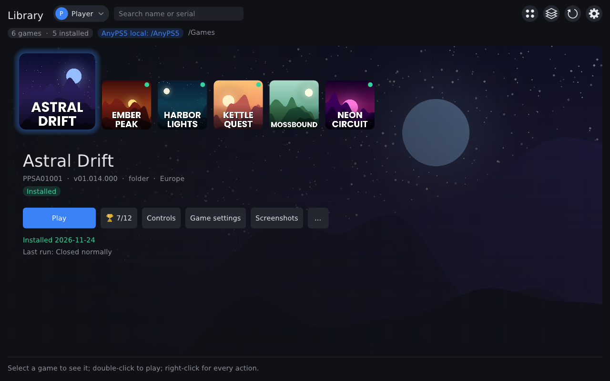
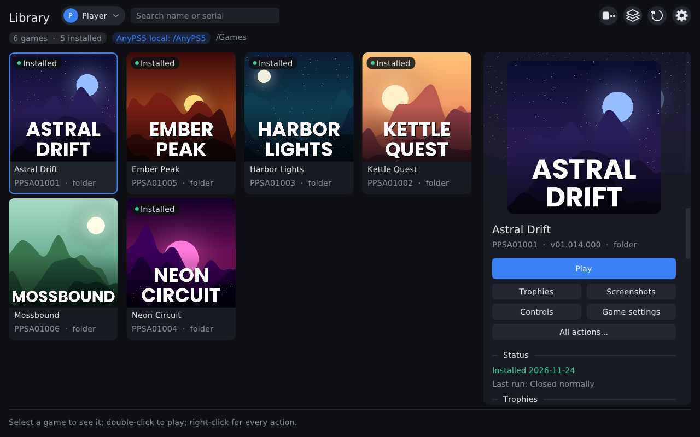
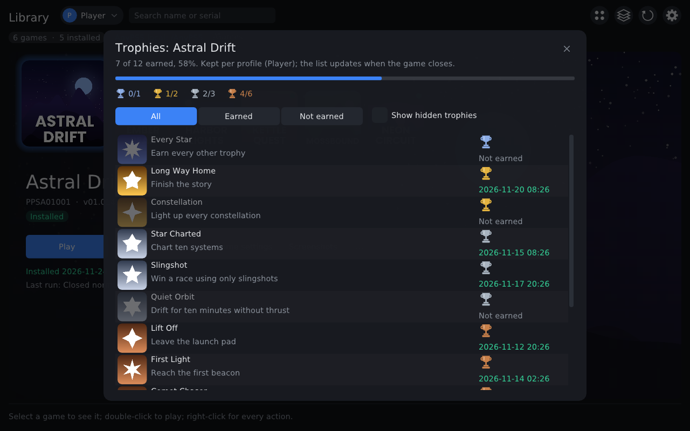
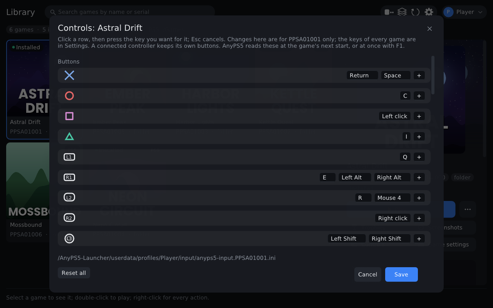
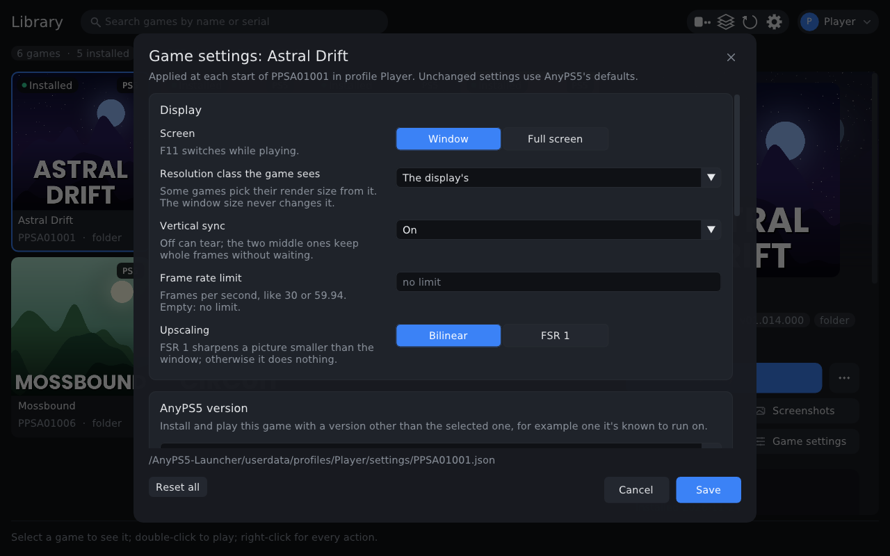
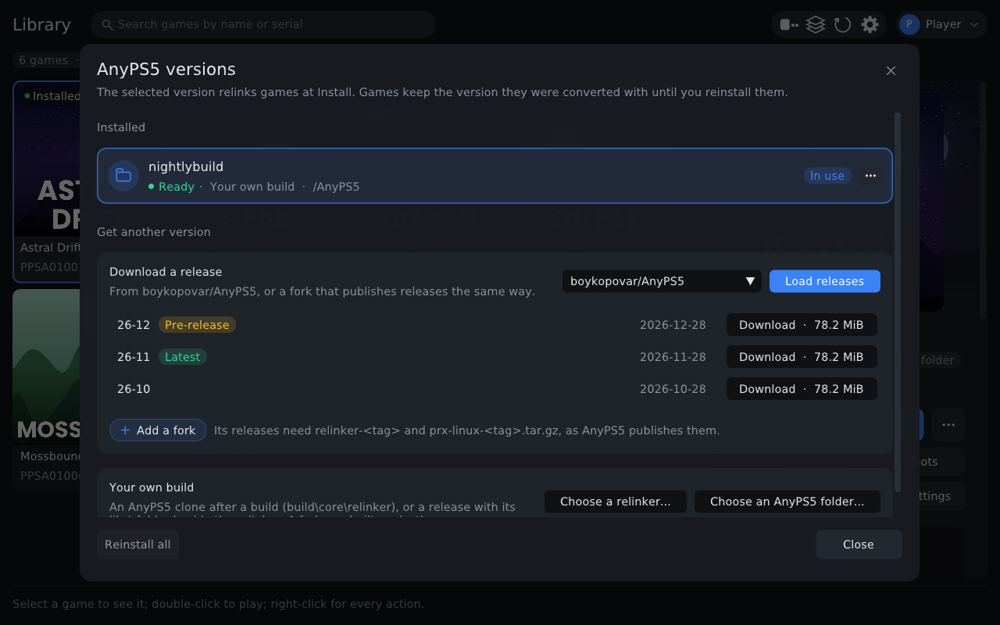

# AnyPS5 Launcher

A desktop frontend for [AnyPS5](https://github.com/boykopovar/AnyPS5): a game list that finds your PS5 games, converts them with the AnyPS5 relinker and launches them, with saves, trophies and settings kept per profile.



| | |
|:---:|:---:|
|  |  |
| Grid view and details | Trophies |
|  |  |
| Controls | Game settings |
|  | |
| AnyPS5 versions | |

<sub>The games in the screenshots are made-up placeholders with generated artwork.</sub>

**Status:** early, but the main loop works:

- **Library:** game folders and `.zar` archives as a cover grid, with search, status badges and a details panel for the selected game. Covers resize with the window (Ctrl + mouse wheel for bigger or smaller); the look follows Windows' light or dark setting, or a choice in Settings.
- **Install with AnyPS5** (right-click): sets the game's own folder up for AnyPS5 and runs the relinker with the game's flags from AnyPS5's `tools\titles.json`. No links of any kind are made.
  - Folder game `Games\Foo\`: its files are moved (renamed) into `Games\Foo\app0\`, and the exe goes into `Games\Foo\`. Run Convert SELF to ELF first if it still has SELF files.
  - `.zar` game `Games\Foo.zar`: the archive is moved unchanged to `Games\Foo\app0.zar`, and only eboot, `sce_sys` and the modules are extracted into `Games\Foo\app0\` (SELF files unwrapped on the way). The game reads the rest from the archive.
  - The exe loads AnyPS5's libraries from AnyPS5's own folder (`--rpath`), so nothing is copied per game. **Remove install** puts everything back.
  - On an Intel CPU the relinker gets AnyPS5's Intel flag (`--to-intel`); the first-start setup says so. **Settings > Converting games** turns it on or off for later installs.
- **Play** (double-click): moves the profile's saves, trophies, `data` and `download0` beside the exe, starts the game, and moves them back when it exits (or at the next start if the launcher was closed). Input mapping and screenshots go to the profile. **Stop** ends it.
- **Profiles:** each has its own saves, trophies, input mapping, screenshots and console language. Pick one from the profile button in the top bar; **Edit** there renames it, sets its console language or deletes it (to the Recycle Bin, and not while a game still has its saves).
- **Conversions** (right-click): SELF to ELF, `.zar` to folder, folder to `.zar`.
  SELF to ELF first stores the originals in `<library>\originals\<serial>-<version>.originals.zip` (for example `PPSA21567-01.018.000.originals.zip`, named from the game's `param.json`), with an `MD5SUMS` list, and checks the zip; then it replaces `eboot.bin`, each SELF `.prx`/`.sprx` in `sce_module`, `sce_modules`, `prx` and the title's module folders, and extra executables with their ELF. Files that can't be unwrapped (encrypted) are left as they are and listed. **Restore original SELF files** puts them back, each checked against its MD5.
- **Store info** in the details panel: region (from the game's content ID), the game's own change notes under "What's new" (`sce_sys/changeinfo/changeinfo.xml`; shown only when the dump has it), and from [PROSPEROPatches](https://prosperopatches.com) the publisher and the update list, so you see "Update available: 01.015.000" or "Up to date", with every update listed and yours highlighted. Only the title ID is sent; answers are cached for a day in `library\cache\prosperopatches\`; it can be switched off in Settings. The site's changelogs sit behind a CAPTCHA, so **View on PROSPEROPatches** opens the page in your browser for those.
- The list shows each game's modules by kind, for example `modules: 12 ELF, 3 SELF`.
- **Settings** in `anyps5-launcher.json` next to the `.exe`.

- **AnyPS5 versions** (top bar): download any release of `boykopovar/AnyPS5` or of a fork that publishes releases, or add a local relinker or AnyPS5 build; pick which one relinks games. If none is set up, the launcher offers to download the latest release at start.

- **Trophies**: the list, texts and icons from the game's own `sce_sys/trophy2`, with what the profile earned (dates, progress, grade counts and the console's percentage). Hidden trophies stay hidden until earned, unless you choose to see them. While you play, each trophy the game earns slides in as a card at the top of the game's window, with a short chime (both can be turned off in Settings).
- **Play time**: how long each profile has played each game, counted from when the game's window shows until it closes and saved every minute. The game's status shows it with the date you last played; hover it for the number of sessions.
- **PS5 / PS4 tag**: each game's tile shows "PS5" or "PS4" (from its title ID) like the console's home screen. Put the Phatboy Slim font (by TracerTong Fontworks, [dafont.com/phatboy-slim.font](https://www.dafont.com/phatboy-slim.font)) in a `fonts` folder next to the launcher's exe to write it in that font; it isn't included with the launcher.
- **Controls**: keyboard and mouse for the pad: every game of the profile in Settings, and one game's own changes under Controls in its details, written as AnyPS5's `anyps5-input.ini` / `anyps5-input.<serial>.ini`. Click Set and press a key; keys used twice are flagged. Also stick dead zones and mouse-as-stick tuning.
- **Artwork**: the game's `pic0.png` behind the details panel.
- **Game settings** (details panel): window or full screen, display, the resolution class the game sees, vertical sync, a frame rate limit, FSR 1 upscaling, the performance overlay, volume, vibration and the game's language, each passed to AnyPS5 as its documented environment variable only when changed. Also the shader cache (on/off, clear), save backups and **Export/Import** of the game's settings and controls as one `.anyps5game` file.
- **Saves**: **Back up saves** zips the profile's saves and trophies of a game into `userdata\backups\<profile>\<serial>\`; **Restore** puts one back after backing up what is there now.
- **Why it stopped**: after each run the details say why in plain words (missing module, a system function AnyPS5 lacks, GPU stopped, out of memory, a crash with its exception), from the run report and the end of the log. **Make a report** writes one text file for a GitHub issue to `library\reports\`, with your user name and home folder removed.
- **Screenshots**: the game's F12 shots in a grid and one at a time; open or delete them.
- **Controllers** (Settings): connected pads with type, USB or Bluetooth and battery, a live button and stick test, vibration, and warnings about Steam Input, DS4Windows, DualSenseX and HidHide. The launcher can be used with a pad: the d-pad moves, ✕ plays, △ opens a game's actions, Options opens Settings.
- **Starting a game** shows a start screen until its window appears; Settings can minimize the launcher while you play.
- **First start**: a short setup (appearance and view, games folder, AnyPS5, profile name).
- **Home view**: a row of game tiles with the selected one large over its artwork, beside the grid (the first icon in the top bar switches).
- **AnyPS5 version per game**: Game settings can pin a game to another installed AnyPS5 version. **Reinstall all** (AnyPS5 versions, or the "games to reinstall" pill) converts every outdated game again, one after another.
- **Save sync** (Settings): a folder your PCs share (OneDrive, Dropbox, USB, network); newer saves come in before a game starts and go out after it ends, and whatever is replaced is backed up first.
- **Links**: `anyps5://play/<title ID>` starts a game and `anyps5://game/<title ID>` shows it, from a shortcut, a browser or Steam (**Copy link** in a game's actions). A launcher that is already open takes the request.
- **Updates**: the launcher checks its GitHub releases at start (Settings → Launcher) and downloads a new one in the background. "Update ready" in the top bar shows what's new; **Restart now** reopens it in a second, in the same place and on the same game, and otherwise it goes in place when you close the launcher. Releases are built by `.github/workflows/release.yml` for each `v*` tag, with the commit titles since the last tag as their notes.
- **Open an issue**: after a run that went wrong, opens a new issue on AnyPS5's GitHub with the facts filled in, for you to check and submit.

This is a separate project. It needs no changes to AnyPS5 and talks to it only through its documented command line, runtime layout, environment variables and run report.

## Building on Windows

Requirements: Git, CMake 3.25 or newer, Ninja, and [WinLibs](https://winlibs.com/) GCC 15 (the toolchain AnyPS5 uses), with its `bin` folder on `PATH`.

First time only, from PowerShell in the repository folder:

```powershell
powershell -ExecutionPolicy Bypass -File tools\bootstrap.ps1
```

This runs `git init` if needed and adds the dependencies as pinned, shallow submodules under `3rdparty\`: SDL 3.4.20, Dear ImGui 1.93.0, nlohmann/json 3.12.0, zstd 1.5.7, ZArchive and stb.

Then:

```powershell
cmake --preset release
cmake --build --preset release
ctest --preset release
build\release\anyps5-launcher.exe
```

On first start a short setup asks for the appearance, your games folder, AnyPS5 and a profile name. If no AnyPS5 version is set up, the launcher offers to download the latest release; you can also add your own build (for example `C:\dev\AnyPS5`) under "AnyPS5 versions" and give it a name of your own (**Rename**); the launcher shows that name, not the folder's path. Downloaded versions go to `anyps5\` beside the launcher. Logs and shader caches go to `library\` and profiles to `userdata\` beside the launcher unless you choose other folders; converted games stay in their own folders in your games folder; keep userdata on the same drive as your games so saves are renamed, not copied, for each run. The AnyPS5 version's folder path must be plain ASCII (the relinker's `--rpath` needs it). Settings are stored next to the `.exe`, so keep the launcher in a folder you can write to. The `tests` preset builds only the core library and its tests, without SDL or ImGui.

After cloning an existing copy, use `git submodule update --init` instead of the bootstrap script.

## Requirements to run

Only Windows 10 or newer. The launcher is a single `.exe` with no runtime to install: no Python, no Visual C++ redistributable, no DLLs beside it.

## Layout

| Path | Contents |
|---|---|
| `src/core/` | Scanner, metadata parsers, executable check, folder and `.zar` readers. No UI. |
| `src/app/` | SDL3 + Dear ImGui window |
| `tests/` | Core tests; they build real `.zar` files with ZArchive's writer |
| `docs/DESIGN.md` | The full plan: folders, launching, saves, trophies, conversion, updates |
| `tools/compare_unwrap_self.py` | Developer check that the built-in SELF unwrapper still matches AnyPS5's `tools/unwrap_self.py` |

## The built-in SELF unwrapper

`src/core/SelfUnwrap.cpp` is a C++ port of AnyPS5's `tools/unwrap_self.py`, so users don't need Python. It must keep producing the same bytes and the same refusal messages as the script. When AnyPS5 changes the script, port the change and run the comparison, which needs Python and an AnyPS5 checkout:

```powershell
cmake --build --preset release --target unwrap_self_cli
python tools\compare_unwrap_self.py --anyps5 C:\dev\AnyPS5 --cli build\release\unwrap_self_cli.exe
```

It runs both on the containers AnyPS5's own `tools/tests/test_unwrap_self.py` builds, plus thousands of mutated variants, and fails on any difference. `tests/UnwrapGolden.hpp` keeps a few of those containers with the SHA-256 of the script's output for the regular test suite.

## Licence

GPL-2.0, the same as AnyPS5. See [LICENSE](LICENSE).
